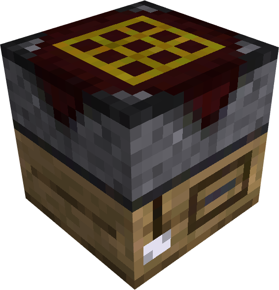
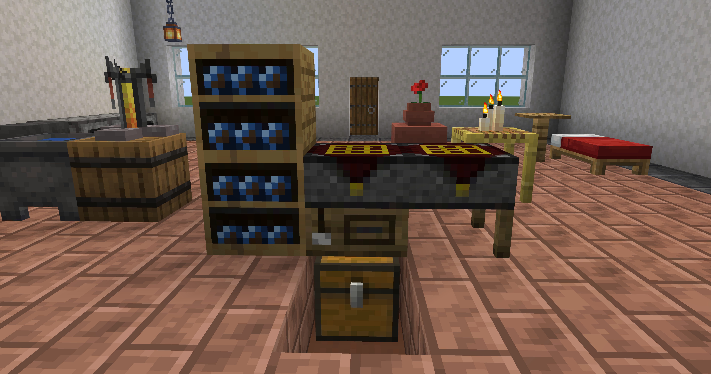

<h1 align="center"></h1>

A crafting bench for Minecraft 1.21.1 (NeoForge) that keeps its recipe laid out, with an inventory of its own that hoppers and pipes can reach, blueprints that store a recipe, and stackable archives that hold them next to the bench.

## What it adds

- **Project Bench**: a crafting table that remembers. Lay a recipe out in its matrix, fill its 18 slots of internal inventory with the materials, and every craft pays from that inventory, so the recipe stays where you put it. Hoppers and pipes reach the inventory by side, and the chests beside the bench show up in its window.
- **Project Bench Slab**: half a bench. Two slabs, or a slab and a bench, join into a **Project Station** with both matrices in one window.
- **Auto Project Bench**: a bench that crafts on a redstone pulse, and an **Ejecting** one that pushes the result out of its back.
- **Blueprint**: holds one crafting recipe and lays it out in the bench as ghosts.
- **Blueprint Archive**: a shelf for blueprints, stackable up to three high; the bench's window lists the blueprints of every column it touches.

It works with JEI, EMI, Jade, Polymorph, Mouse Tweaks, Inventory Profiles Next and Iron Chests, all optional. Everything is configurable in `config/projectbench-common.toml` and `config/projectbench-client.toml`.

The [wiki](wiki/Home.md) has every detail: [Project Bench](wiki/Project-Bench.md), [Blueprints](wiki/Blueprints.md), [Blueprint Archive](wiki/Blueprint-Archive.md), [Hoppers and Pipes](wiki/Hoppers-and-Pipes.md), [Works With Other Mods](wiki/Works-With-Other-Mods.md) and [Configuration](wiki/Configuration.md).

## Installation

Project Bench needs Minecraft 1.21.1 and NeoForge 21.1.250 or newer, on the client and on the server. Put the jar in the `mods` folder of both.

## Building

You need Java 21. The Gradle wrapper does the rest.

- `./gradlew build` compiles the mod, runs the unit tests and puts the jar in `build/libs`.
- `./gradlew runClient` starts a development client with NeoForge and Project Bench only; `./gradlew runServer` does the same for a server.
- `./gradlew runData` writes the generated models, blockstates, recipes, loot tables and tags into `src/main/generated`.
- `./gradlew runGameTestServer` runs the GameTests and stops.

### Try it

`./gradlew runClientWithMods` starts the development client with JEI, Jade, Polymorph, Mouse Tweaks and Iron Chests already installed. The list is in `client-mods.json`: the jars are downloaded from Modrinth into `run/mods` the first time and checked against their SHA-512. Add `-PinventoryMods` to also get Storage Drawers, Sophisticated Storage, Functional Storage and Create, `-Pviewer=emi` to use EMI in place of JEI, and `-PdisableMods=name,name` to leave some out. `runClient` and `runServer` set those jars aside (renamed to `.jar.disabled`), so they stay plain NeoForge.

## License

[GNU GPL v3 or later](LICENSE).
