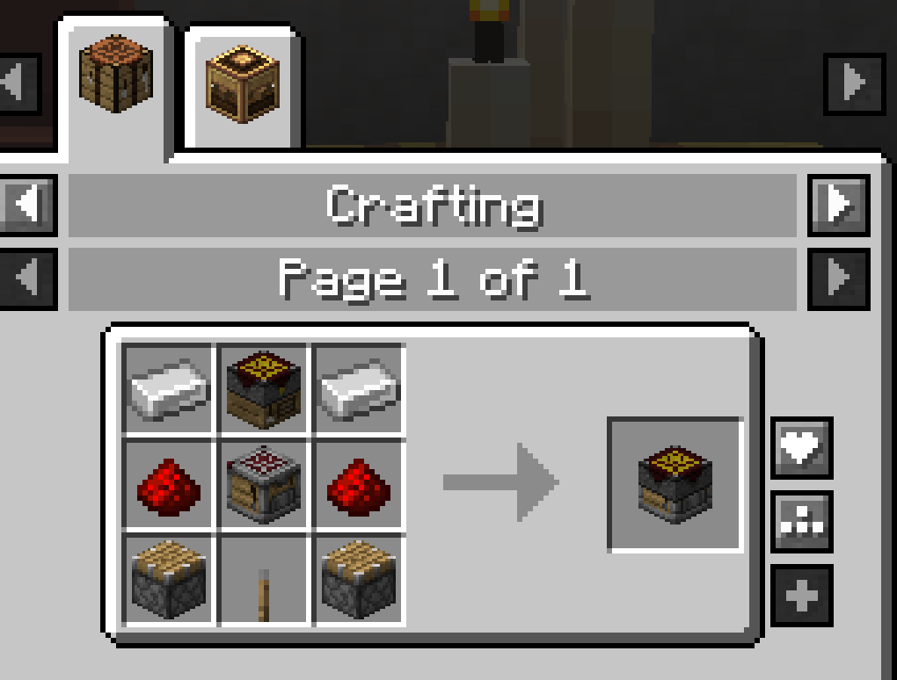
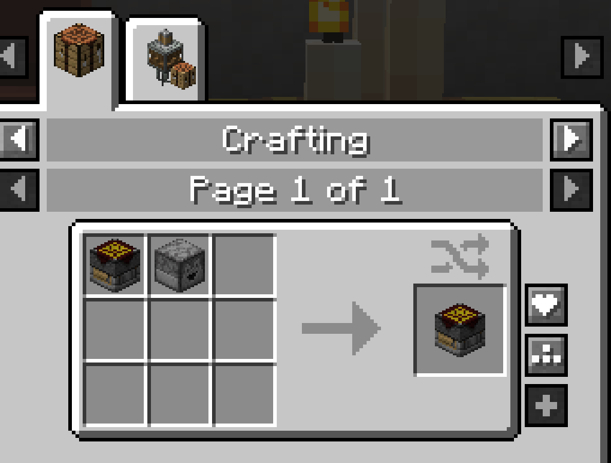
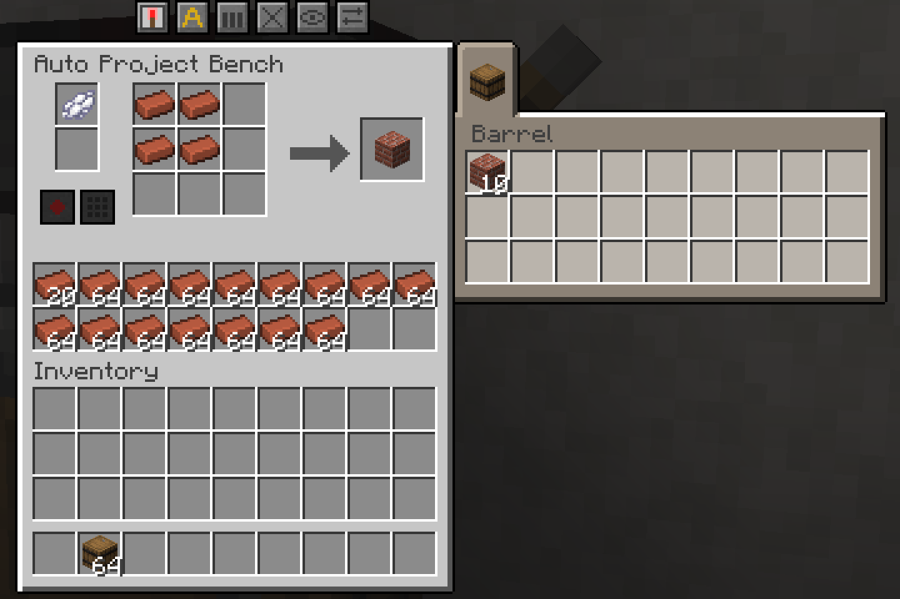
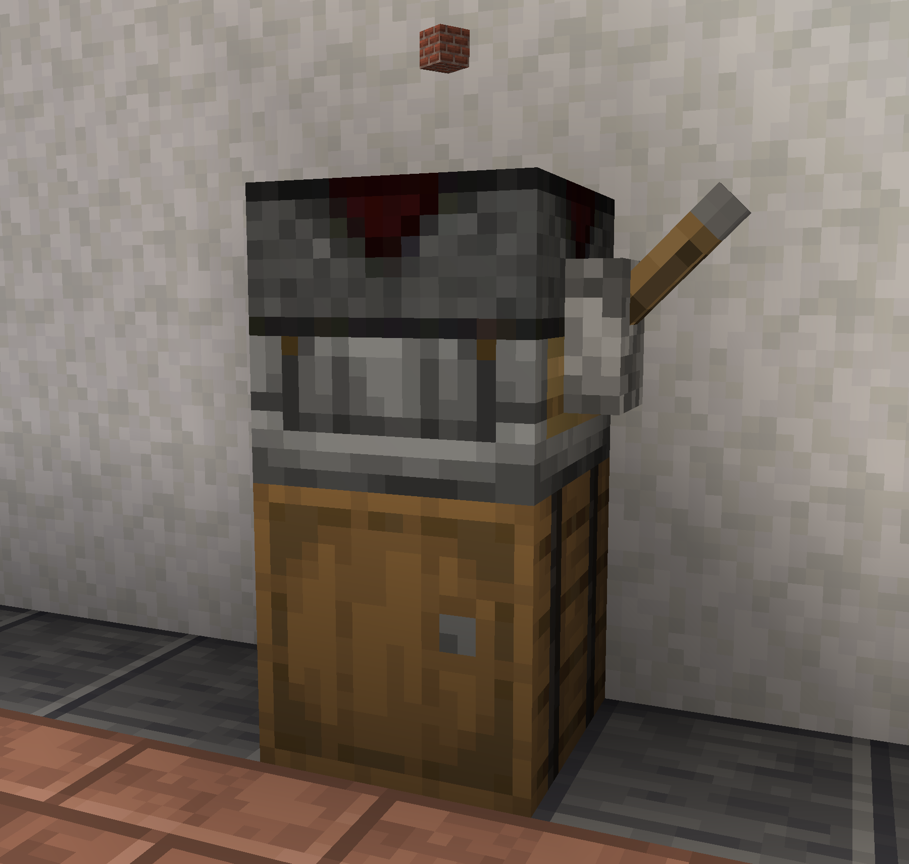
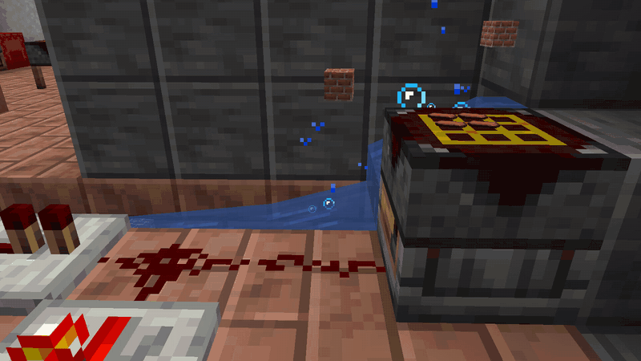

# Auto Project Bench

The **Auto Project Bench** crafts once on each redstone pulse, like the vanilla crafter. It keeps everything a [Project Bench](Project-Bench.md) has: the recipe stays laid out, the storage refills the grid, and blueprints work. The **Ejecting Auto Project Bench** sends the result out of its back instead.

| | |
|---|---|
| **Type** | Block (automatic crafter) |
| **Stack size** | 64 |
| **Obtained by** | Crafting, from a Project Bench |
| **Config section** | [Automatic benches](Configuration.md#automatic-benches), [Hoppers and pipes](Configuration.md#hoppers-and-pipes) |

## Crafting

*The Auto Project Bench recipe*

*The Ejecting Auto Project Bench recipe*

The upgrade keeps what the old bench held. Break a full bench with Silk Touch, craft the upgrade, and nothing is lost: grid, storage, blueprint, dye and slot locks.

## Using it

The window is the same as the [Project Bench](Project-Bench.md#using-it)'s, with one more button: **Automation**. Mine it with a pickaxe.

*The window of an Auto Project Bench crafting bricks, with a barrel's tab beside it*

### Crafting with redstone

*An Auto Project Bench with a lever beside it and a barrel below, the result floating above*

1. Lay out a recipe in the grid and stock the storage.
2. Place a chest or other storage block under the bench.
3. Send a redstone pulse. A moment later, the bench crafts once and puts the result in the chest below.

- One pulse makes one craft. Holding the signal on does nothing more.
- Turn the signal off and on again for the next craft.
- With no chest below, or a full one, the pulse does nothing and spends nothing.
- If the chest below takes only part of the result, the rest goes to the bench's storage.
- Leftovers, like empty buckets, go to the storage. When it is full, they go where the result goes.

### The ejecting bench

*An Ejecting Auto Project Bench throwing its results out of the back, carried off by a stream of water*

The **Ejecting Auto Project Bench** puts the result in the storage block behind it. With nothing there, it throws the result out of its back, like a dropper.

### Crafting by pulling

A hopper or pipe under the bench can take results without any redstone. Each pull crafts.

A hopper takes one item at a time. A craft that makes four sticks hands over one, and the other three wait in the storage. The next pulls take those first, without crafting.

### Automation button

Turn **Automation** off and the bench only crafts by hand, like a normal bench. Its bottom side closes too. New benches start with it on.

### Rules it follows

- The limited crafting game rule does not stop it, just like a crafter.
- An automatic bench never joins a [slab](Project-Bench-Slab.md).
- **Share** on the open tab works like none, because nobody has the window open.

### Sides

| Side | Reaches |
|---|---|
| Top | The grid |
| Left, right, back | The storage |
| Front | The blueprint slot and the dye slot |
| Bottom | The result: taking out crafts, nothing goes in |

See [Hoppers and Pipes](Hoppers-and-Pipes.md) for how each side behaves.

## Controls

| Control | Where | What it does | Notes |
|---|---|---|---|
| **Automation** | Button bar | Turns redstone and pull crafting on or off. | Its tooltip says "Automation: on" or "Automation: off". |
| Redstone pulse | Any side | Crafts once. | Only when the signal turns on. |
| Comparator | Next to the bench | Reads how full the storage is. | |

All other controls are the same as the [Project Bench](Project-Bench.md#controls)'s.

## Tips

- Put a hopper on the left side and a chest under the bench for a simple crafting line.
- Use a comparator to stop the line when the storage runs low.
- A pipe on the front can swap blueprints to change what the bench crafts.
- With **Share** on all, the bench refills its grid from the chests next to it.

## Compatibility

- **Jade**: shows the recipe and whether automation is on.
- **JEI** and **EMI**: list the upgrade recipes like any crafting recipe.

Other mods work as on the [Project Bench](Project-Bench.md). Details are on [Works With Other Mods](Works-With-Other-Mods.md).

## Configuration

Server owners can turn the automatic benches off. The ones already placed then work as normal benches. They can also change what each side reaches. See [Automatic benches](Configuration.md#automatic-benches) and [Hoppers and pipes](Configuration.md#hoppers-and-pipes).

## See also

- [Project Bench](Project-Bench.md)
- [Hoppers and Pipes](Hoppers-and-Pipes.md)
- [Blueprints](Blueprints.md)

[Back to Home](Home.md)
