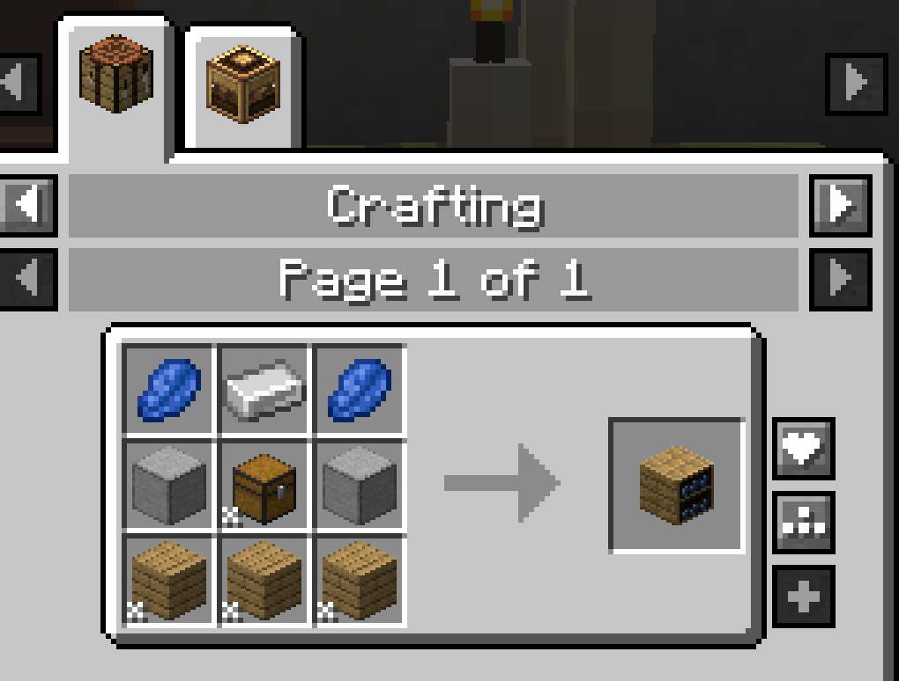
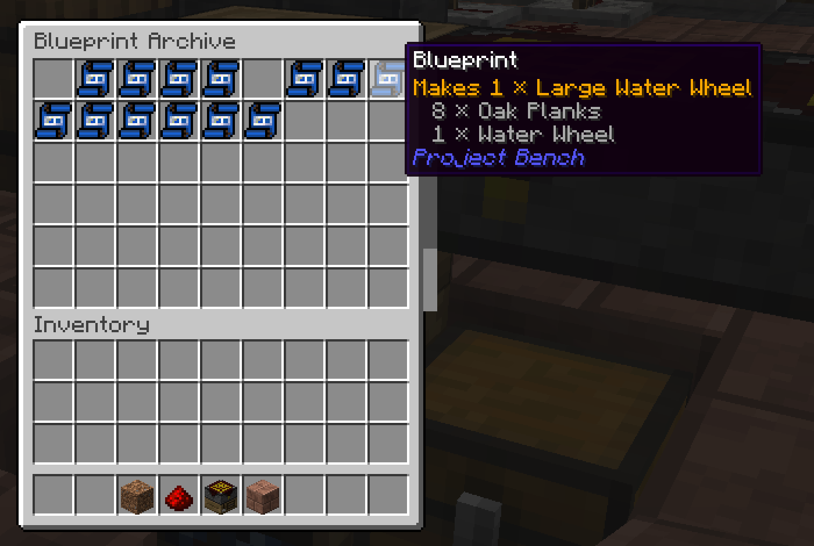
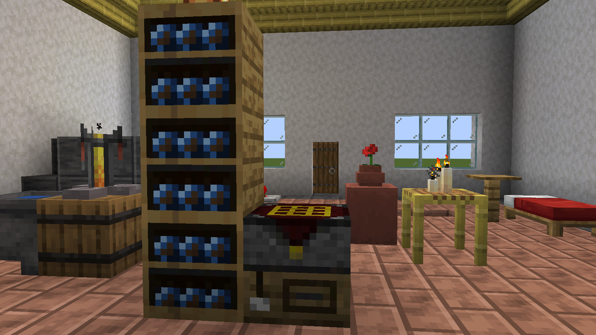
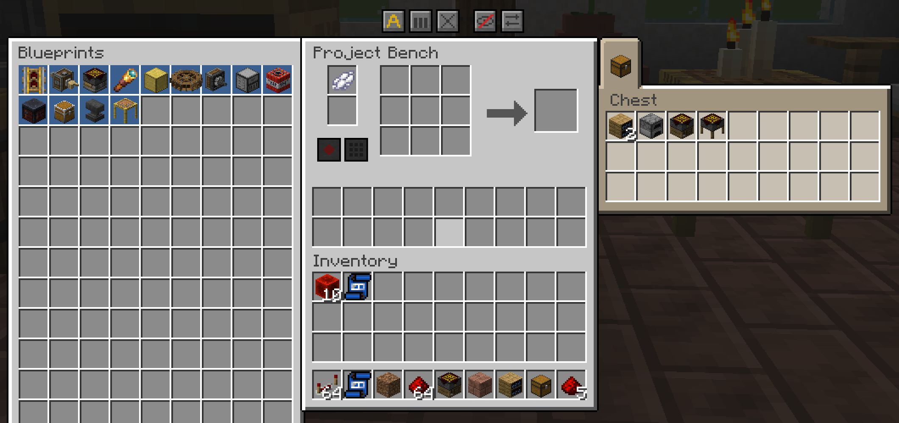

# Blueprint Archive

The **Blueprint Archive** is a shelf for your [blueprints](Blueprints.md), with 36 slots. Place it next to a [Project Bench](Project-Bench.md) and its blueprints show up in the bench's window. Archives stack into tall columns that share their contents.

| | |
|---|---|
| **Type** | Block (storage) |
| **Stack size** | 64 |
| **Obtained by** | Crafting |
| **Config section** | [Blueprint Archive](Configuration.md#blueprint-archive) |

## Crafting

*The Blueprint Archive recipe*

Any wooden chest and any kind of planks work.

## Using it

### Storing blueprints

*The archive's own window with recorded blueprints; hover one to see what it makes*

Right-click the archive to open it.

- Each slot holds up to 64 blank blueprints, or one recorded blueprint.
- Only blueprints go in.

### Stacking archives

*A column of three stacked archives beside a bench*

Stack archives on top of each other, up to three high. The column works as one big archive.

- Its window shows the blueprints of every block in the column. Scroll to see them all.
- Hoppers and pipes reach the whole column, whichever block they touch.
- A fourth archive on a full column starts a new column.
- Archives side by side stay separate.
- Break one and the rest regroup on their own. Each block keeps what it held.

### Next to a bench

*The bench window with the archive panel open, listing the blueprints of the archives beside it*

Place an archive against any side of a bench. The bench's window then shows an archive panel. It lists every blueprint in the archives touching the bench, whole columns included.

A recorded blueprint shows the item it makes. Hover it to see its tooltip.

The panel shows twelve rows of nine blueprints, so a column of three archives fits without scrolling. With more, scroll the list.

The panel lists the archives that were there when you opened the window. Placed a new one? Reopen the window.

### Hoppers and pipes

Hoppers and pipes can put blueprints in from any side. They can only take them out from the bottom. Anything that is not a blueprint stays out. See [Hoppers and Pipes](Hoppers-and-Pipes.md).

### Breaking and moving

- Any tool breaks the archive. An axe is fastest.
- Breaking it drops the archive and every blueprint in it.
- Silk Touch keeps the blueprints inside the archive item. Place it again and they are back.
- Moving it whole, for example with a Create contraption, keeps everything inside.

## Controls

These work in the bench's archive panel.

| Control | Where | What it does | Notes |
|---|---|---|---|
| Click with an empty hand | A recorded blueprint | Swaps it with the blueprint in the bench. | |
| Click with an empty hand | A stack of blank blueprints | Puts one in the bench's blueprint slot. | Only when that slot is empty. |
| Click with a blueprint | Any panel slot | Stores the blueprint there, or swaps it with the one in the slot. | |
| Shift+click | A blueprint in your inventory or the bench | Sends it to the archive. | Joins matching blueprints first. A blank one fills the bench's empty blueprint slot first. |
| Mouse wheel | The panel | Scrolls the list. | Only when it holds more than fits. |

## Tips

- Keep one archive column next to each bench you use for a project.
- Put a hopper on top to fill the archive, and one below to empty it.
- Shift-click a whole stack of blank blueprints to fill the bench's slot and store the rest.

## Compatibility

The archive needs no other mod. Hoppers and pipes from any mod can use it. See [Works With Other Mods](Works-With-Other-Mods.md) for the bench.

## Configuration

Server owners can change the column height, how many blank blueprints fit in a slot, and the hopper sides. They can also remove the panel from the bench. See [Blueprint Archive](Configuration.md#blueprint-archive) on the Configuration page.

## See also

- [Blueprints](Blueprints.md)
- [Project Bench](Project-Bench.md)
- [Hoppers and Pipes](Hoppers-and-Pipes.md)

[Back to Home](Home.md)
