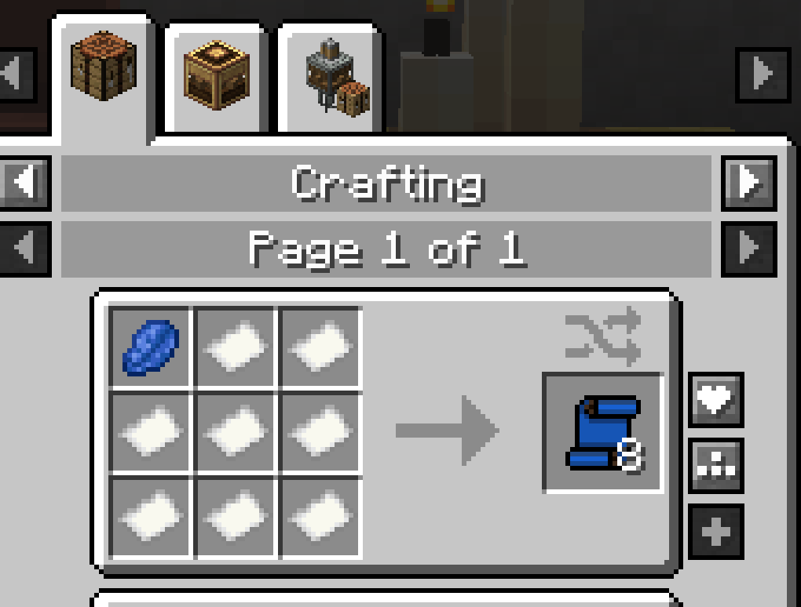
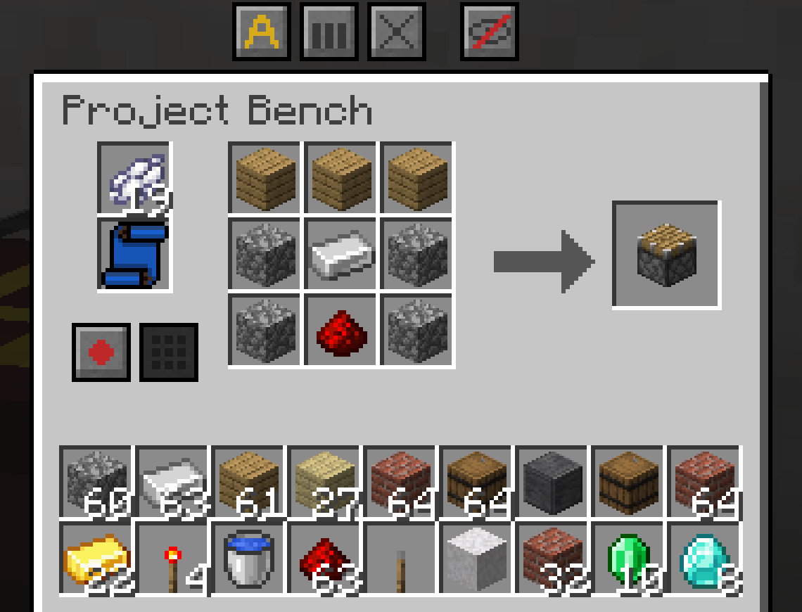
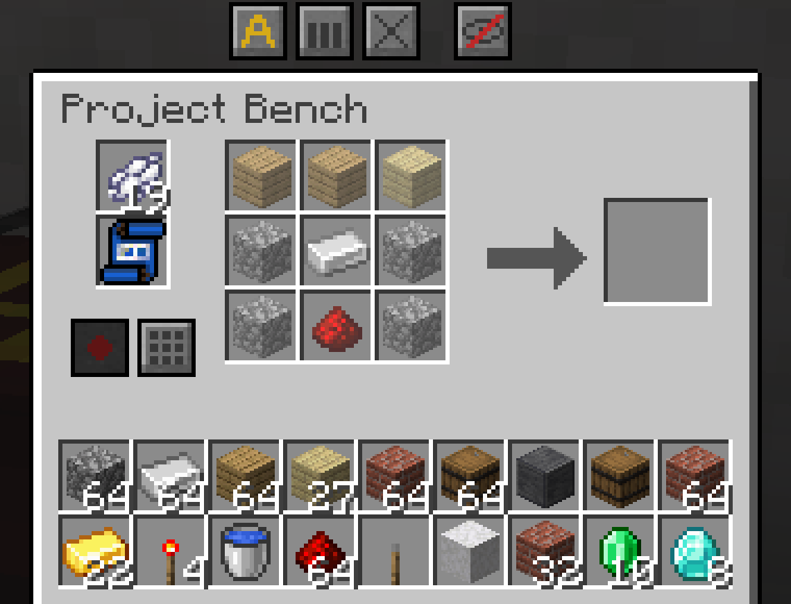

# Blueprint

A **Blueprint** remembers a crafting recipe. Put a recorded one in a [Project Bench](Project-Bench.md) and it shows where each ingredient goes. It can also lay the whole recipe out for you.

| | |
|---|---|
| **Type** | Item |
| **Stack size** | 64 blank, 1 recorded |
| **Obtained by** | Crafting |
| **Config section** | [Blueprints](Configuration.md#blueprints) |

## Crafting

*The Blueprint recipe, which makes eight blank blueprints*

One recipe makes eight blank blueprints.

## Using it

### Recording a recipe

*Recording a recipe: the recipe in the grid, a blank blueprint in its slot and the dye above it*

1. Put a blank blueprint in the bench's blueprint slot.
2. Put one white dye in the dye slot next to it. That is what recording costs.
3. Lay the recipe out in the grid.
4. Press **Record**.

The blueprint now holds the recipe and what it makes. The dye is used up.

- The dye slot only takes the recording cost.
- Shift-click white dye from your inventory and it goes to the dye slot.
- A hopper on the bench's front keeps the dye slot stocked.
- Without enough dye, **Record** does nothing. Its tooltip says what is missing.

### Recording from JEI or EMI

You can record a recipe you cannot craft yet:

1. Put a blank blueprint and the dye in the bench.
2. Find the recipe in JEI or EMI.
3. Press **+** in JEI, or the fill button in EMI.

The recipe is recorded. The ingredients you have go into the grid, and the missing ones show as ghosts. Without the dye, JEI and EMI only lay the recipe out.

### Ghosts

*A recorded blueprint in the bench: every empty grid slot shows a faded ghost of the item it needs*

Put a recorded blueprint in the bench's blueprint slot. Every empty grid slot the recipe needs shows a faded ghost of its item. The blueprint does not move anything by itself.

- Shift-click a stack and it goes to the slots whose ghost wants it, shared out evenly.
- Items the blueprint does not want go to the storage as usual.
- A worn tool can fill the ghost of the same tool.
- Hoppers that feed the grid only fill the slots the ghosts want. See [Hoppers and Pipes](Hoppers-and-Pipes.md).

### Fill

Press **Fill** and the bench lays the whole recipe out from its storage and the shared chests.

- Each ingredient is spread evenly, so you get as many crafts as possible.
- Each slot gets up to a full stack.
- Items in the grid that the blueprint does not want go back to the storage first.
- If an ingredient runs short, the ghosts show what is missing.

### Picking the right recipe

When the grid matches more than one recipe, the blueprint picks the one it recorded.

### Tooltip

Hover a recorded blueprint to see what it makes and its ingredients.

### Wiping a blueprint

Put a recorded blueprint alone in any crafting grid to get a blank one back.

## Controls

| Control | Where | What it does | Notes |
|---|---|---|---|
| **Record** | Bench window, by the blueprint slot | Writes the grid's recipe on the blank blueprint. | Spends the recording cost from the dye slot. |
| **Fill** | Bench window, by the blueprint slot | Lays the blueprint's recipe out in the grid. | Takes from the storage and the shared chests. |
| Shift+click | Your inventory or the storage | Sends items onto the ghosts that want them. | Shared out evenly. |

## Tips

- Swapping blueprints never moves what is already in the grid.
- A pipe on the bench's front can swap blueprints, so one bench can switch recipes.
- Record one blueprint per recipe you use often, and keep them in a [Blueprint Archive](Blueprint-Archive.md).
- Record a recipe from JEI or EMI before you gather its ingredients, then let the ghosts guide you.

## Compatibility

- **JEI**: **+** records the recipe on a blank blueprint in the bench.
- **EMI**: the fill button records the recipe on a blank blueprint in the bench.

Details are on [Works With Other Mods](Works-With-Other-Mods.md).

## Configuration

Server owners can change the recording cost or make recording free. They can also stop shift-click from filling ghosts, or hide ingredients from the tooltip. See [Blueprints](Configuration.md#blueprints) on the Configuration page.

## See also

- [Project Bench](Project-Bench.md)
- [Blueprint Archive](Blueprint-Archive.md)
- [Works With Other Mods](Works-With-Other-Mods.md)

[Back to Home](Home.md)
