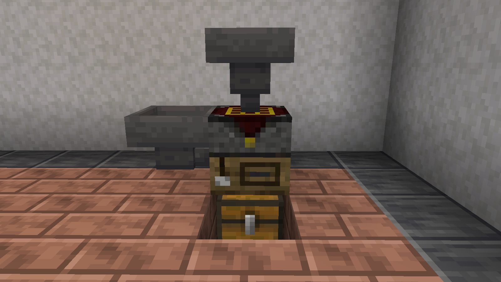

# Hoppers and Pipes

Hoppers, pipes and the item movers of other mods can work with every block of Project Bench. What they reach depends on the side they touch. This page lists every side of every block.

*A bench with a hopper on top, another on its left and a chest below*

## How sides are named

Sides turn with the block. The front is the side that faced you when you placed it. Left and right are as you look at the front. Top and bottom are top and bottom.

## Project Bench and Project Bench Slab

| Side | Reaches | Items go into | Items come out of |
|---|---|---|---|
| Left, right, bottom | Storage | The storage | The storage, then the grid |
| Back, top | Grid | The grid | The grid, then the storage |
| Front | Blueprint slot | The blueprint slot and the dye slot | The blueprint slot and the dye slot |

The result is never reachable. Only a player takes a craft from a [Project Bench](Project-Bench.md). For crafting by machine, use an [Auto Project Bench](Auto-Project-Bench.md).

### Filling the grid

A hopper on the top or back fills the grid in a set order:

- **With a recorded blueprint**: only the slots whose ghost wants the item, emptiest first. The ghosts fill evenly, and other items stay out.
- **Without a blueprint**: the item tops up the slots that already hold it, then takes the first empty slot.

### Filling the storage

A hopper on the left or right fills the storage. The bench uses the storage to refill the grid as you craft. [Locked slots](Project-Bench.md#locked-slots) only take their own item, from hoppers too.

### Emptying the bench

A hopper below takes items out of the storage first. When the storage is empty, it takes from the grid.

### The front

A hopper or pipe on the front reaches only the blueprint slot and its dye slot. Use it to keep the dye stocked, or to swap blueprints so one bench can change recipes.

## Project Station

Each half of a [Project Station](Project-Station.md) has its own sides, like a bench on its own. The side where the two halves touch is closed.

## Auto Project Bench

The [Auto Project Bench](Auto-Project-Bench.md) and the ejecting one have their own sides:

| Side | Reaches | Items go into | Items come out of |
|---|---|---|---|
| Top | Grid | The grid | The grid, then the storage |
| Left, right, back | Storage | The storage | The storage, then the grid |
| Front | Blueprint slot | The blueprint slot and the dye slot | The blueprint slot and the dye slot |
| Bottom | Result | Nothing | Crafted results |

Taking from the bottom crafts. A hopper takes one item at a time, so the rest of a craft waits in the storage. The next pulls take those first, without crafting.

With the bench's **Automation** button off, the bottom is closed.

## Blueprint Archive

| Side | Put blueprints in | Take blueprints out |
|---|---|---|
| Every side | Yes | Only the bottom |

Only blueprints go into a [Blueprint Archive](Blueprint-Archive.md). A stacked column works as one: a hopper on any block reaches the whole column.

## Tips

- Put a hopper on the left side of a bench to keep its storage stocked.
- Record a blueprint before you feed the grid by hopper, so items only go where the recipe needs them.
- Put a hopper on the front to keep the dye slot full for recording.
- A chest under an Auto Project Bench catches every craft.

## Configuration

Server owners can choose what every side of the bench and the Auto Project Bench reaches. They can also choose which archive sides take blueprints in and out. See [Hoppers and pipes](Configuration.md#hoppers-and-pipes).

## See also

- [Project Bench](Project-Bench.md)
- [Auto Project Bench](Auto-Project-Bench.md)
- [Blueprint Archive](Blueprint-Archive.md)

[Back to Home](Home.md)
