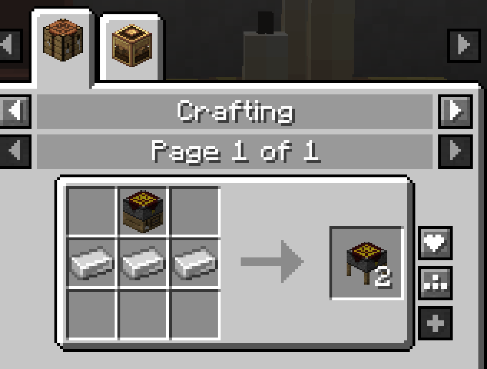
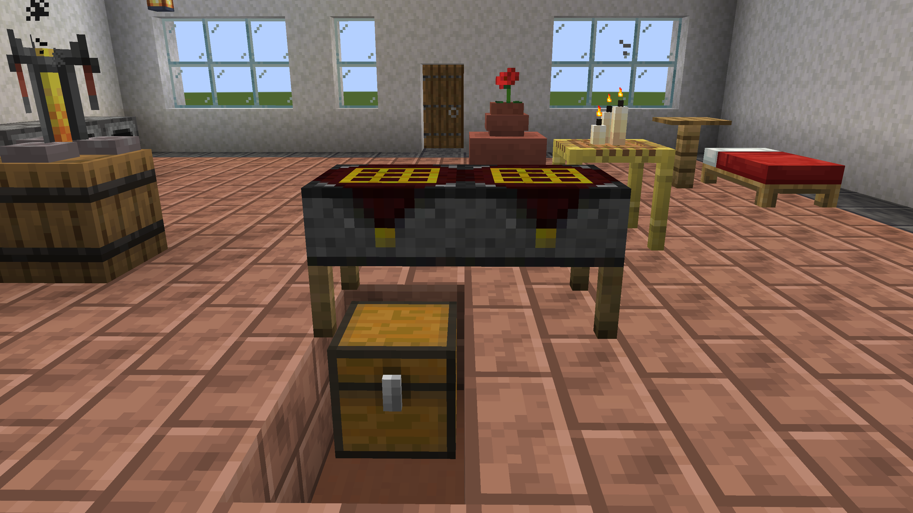
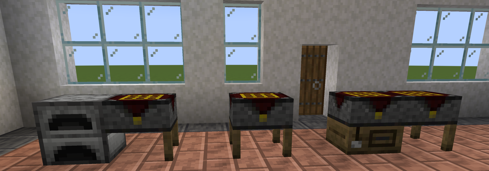

# Project Bench Slab

The **Project Bench Slab** is half a [Project Bench](Project-Bench.md) on four short legs. It has the same grid, storage, blueprint slot and buttons. Place two halves side by side and they join into a [Project Station](Project-Station.md).

| | |
|---|---|
| **Type** | Block (crafting station) |
| **Stack size** | 64 |
| **Obtained by** | Crafting, from a Project Bench |
| **Config section** | [Slab and Project Station](Configuration.md#slab-and-project-station) |

## Crafting

*The Project Bench Slab recipe, which makes two slabs*

One recipe makes two slabs.

## Using it

On its own, a slab works exactly like a [Project Bench](Project-Bench.md). Mine it with a pickaxe.

### Joining

*Two slabs joined into a Project Station*

Place a slab next to another slab or next to a bench, facing the same way. They join, like two chests make a double chest. Open either half and you get the [Project Station](Project-Station.md).

- Two full benches never join.
- An [Auto Project Bench](Auto-Project-Bench.md) never joins anything.
- A block joins only one partner. With three in a row, the last one placed stays alone.
- To keep a slab on its own next to another one, sneak and place it by clicking the floor, not the other slab. Sneak and click the side of a slab, and the two join, taking that slab's direction.
- Each half keeps and drops its own items.

### Legs

*A slab alone, a slab against a furnace and a slab pair on top of a bench*

The legs follow what is around the slab:

- A side loses its legs next to its partner.
- A side also loses its legs against a solid block, like a wall, a furnace or a chest.
- A torch or a flower does not count.
- A slab on top of another slab or a bench stands on it, like a two-floor table.

So two slabs look like one long table, and a slab against a wall stands on its front legs.

## Controls

The slab has the same controls as the [Project Bench](Project-Bench.md#controls).

| Control | Where | What it does | Notes |
|---|---|---|---|
| Sneak + place on the floor | Beside a slab or bench | Places the slab on its own, without joining. | |
| Sneak + click the side | A slab on its own | Joins the new slab to it. | The new slab takes the direction of the slab you clicked. |

## Tips

- A slab next to a full bench gives you a second grid without a second full bench.
- One recipe makes two slabs, which is enough for a whole Station.
- A slab that is not joined always keeps its legs, except on a side against a solid block. A row of them looks like a row of separate tables.

## Compatibility

The slab works with the same mods as the bench. See [Works With Other Mods](Works-With-Other-Mods.md).

## Configuration

Server owners can turn the slab off. Then every bench works alone. See [Slab and Project Station](Configuration.md#slab-and-project-station).

## See also

- [Project Bench](Project-Bench.md)
- [Project Station](Project-Station.md)
- [Hoppers and Pipes](Hoppers-and-Pipes.md)

[Back to Home](Home.md)
