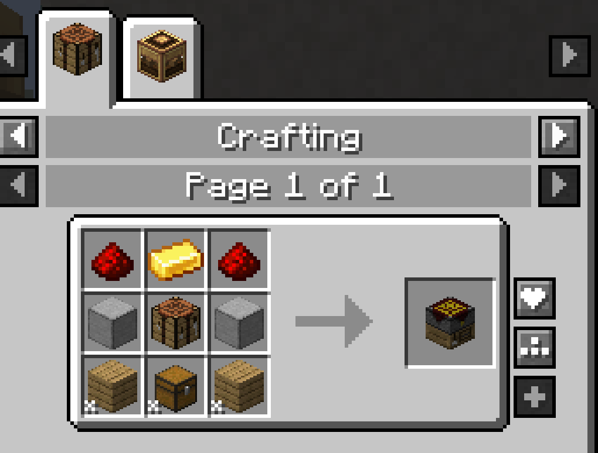
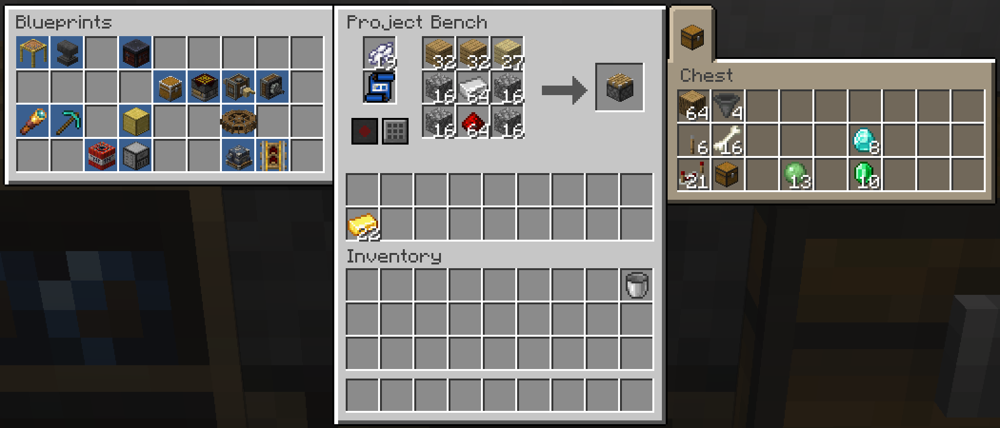
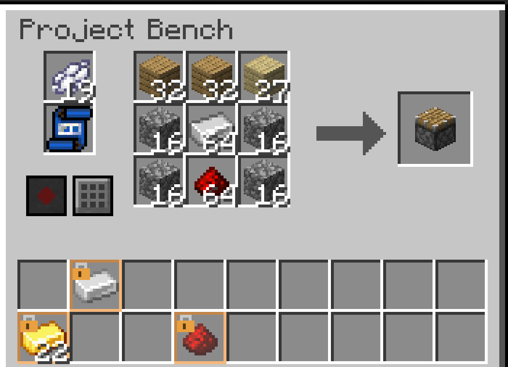
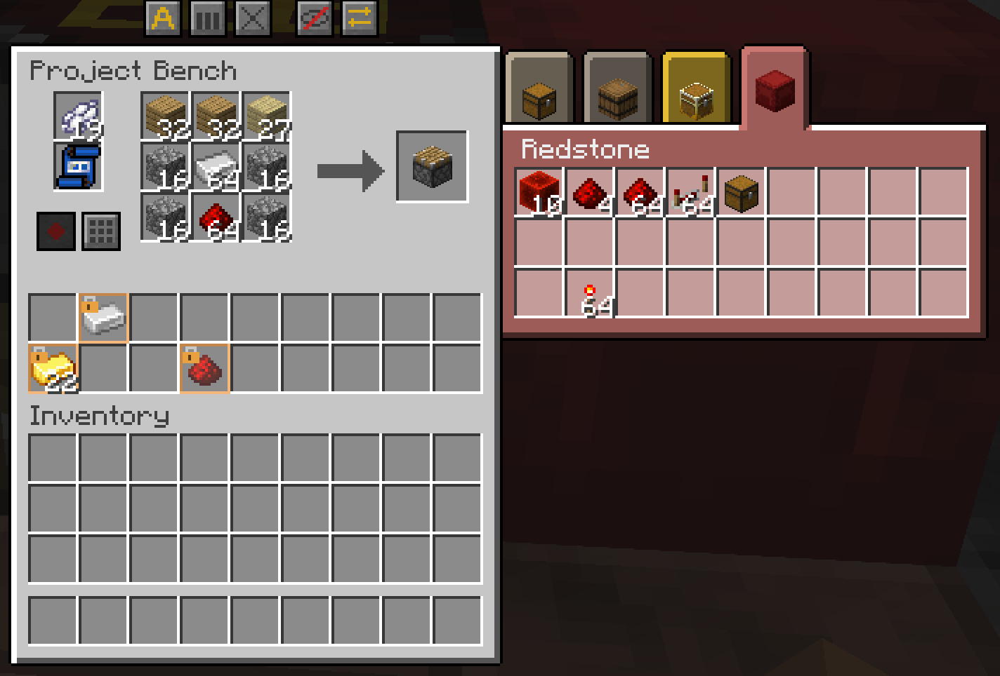
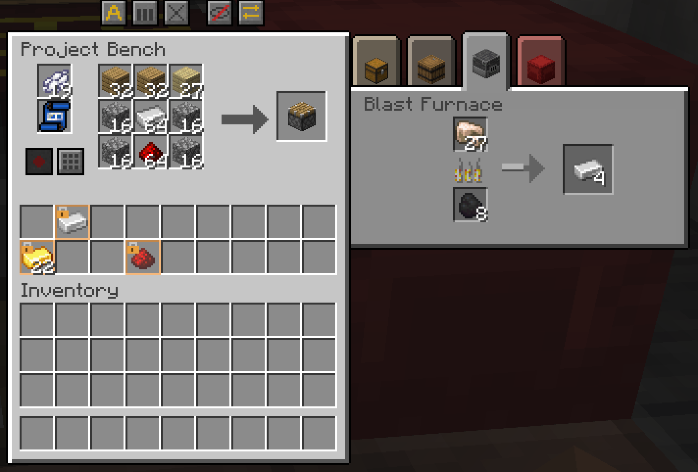
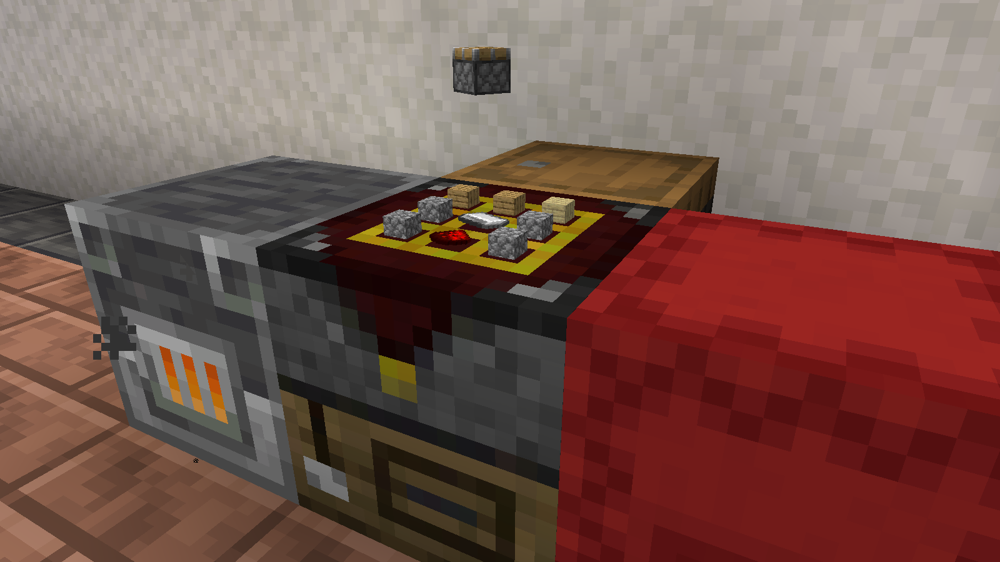

# Project Bench

The **Project Bench** is a crafting table that keeps what you put in it. Your recipe stays laid out after you close the window. Its own 18 slots of storage refill the grid as you craft.

## Crafting

*The Project Bench recipe*

Any kind of planks and any wooden chest work.

## Using it

*The bench window with a recipe, the storage, the archive panel and a chest's tab*

1. **Buttons**: see [Controls](#controls).
2. **Blueprint slot**: holds a [blueprint](Blueprints.md). A small slot next to it holds the dye that recording costs.
3. **Grid and result**: a 3×3 crafting grid, like a crafting table's.
4. **Storage**: 18 slots. This is the bench's own inventory.
5. **Archive panel**: the blueprints of the [archives](Blueprint-Archive.md) next to the bench.
6. **Chest panel**: the chests next to the bench, one tab each.
7. **Your inventory**.

The bench crafts every recipe a crafting table can, from vanilla and from other mods.

### Two recipes for one pattern

Sometimes two mods add recipes with the same pattern. A recipe button then appears next to the result. Click it, see what each recipe makes, and pick one. The bench remembers your choice.

### Limited crafting

With the `doLimitedCrafting` game rule on, the bench works like a crafting table. A recipe you have not unlocked shows no result, and the result slot tells you why. Each player sees their own result.

### Filling the bench with shift-click

Shift-click an item in your inventory and the bench sends it to the first place with room:

1. Grid slots whose blueprint ghost wants the item, shared out evenly.
2. Grid slots that already hold the same item, up to a full stack.
3. The bench's storage.
4. The chests next to the bench, when **Share** allows it.

Shift-click an item in the storage and it goes to the grid, then to the shared chests, then to you.

### Locked slots

*Locked slots in the bench's storage, one holding items and others waiting for theirs*

You can lock a storage slot to one item:

1. Put the item in a storage slot.
2. Middle-click the slot (the pick block button).
3. The slot now shows it is locked. When empty, it still shows which item it takes.

Middle-click it again while the slot is empty to unlock it. While it still holds items, middle-click does nothing.

In creative mode, middle-click on a storage slot locks it instead of copying the stack.

Locks stay with the bench when you break it with Silk Touch or upgrade it.

### Chests next to the bench

*The chest panel with four tabs, each tinted by its block, and a shulker box selected*

Place chests, barrels, shulker boxes, drawers or other storage blocks against the sides or bottom of the bench. A block on top does not count.

Each one gets a tab in the chest panel, up to five. The panel shows the block's name, so a renamed chest shows your name. Its slots work like the chest's own window. A block that refuses an item still refuses it here.

A click never takes more than one stack, even from a drawer that holds thousands. With an item in your hand, clicking such a slot does nothing: put items in with shift-click.

Create's Item Vault shows its items in its tab. As in Create, you cannot take from it or put into it by hand. The bench still uses it as **Share** says.

Each tab gets a soft tint of its block's colour, so a red shulker box looks red and a wooden drawer looks like its wood. Each player can change these colours.

The **Share** button decides whether the bench uses these chests:

- **Taking**: when a craft empties a grid slot and the storage has none of that item, the bench takes one from the chests. **Fill** takes from them too.
- **Sending**: what **Clear** cannot fit, leftovers that do not fit, and shift-clicks the storage cannot take go to the chests.
- **Which chest**: with Share on all, an item goes to the chest that already holds it, then to the first with room.
- **Shift-click in a tab**: the item goes to the bench (grid, then storage, then you). With Share off, it goes straight to you.

[Blueprint archives](Blueprint-Archive.md) do not count as chests here. They have their own panel.

### Furnaces and brewing stands next to the bench

*A blast furnace's tab, smelting raw iron beside the bench*

Put a furnace, a blast furnace, a smoker or a brewing stand against the bench and it gets a tab too. That tab works like the block's own window: put in what you want to smelt or brew and the fuel, watch it work, and take what comes out. A furnace still gives you its experience when you take the result. Shift-click from your inventory sends things where the block itself would put them.

These are machines, not chests. The bench never takes from them or puts anything into them on its own, whatever **Share** says. A machine from another mod that shows different slots on different sides gets no tab, unless the configuration says otherwise.

### Showcase

*The showcase: the grid's items on top of the bench and the result floating above*

Turn on **Showcase** and the grid's items lie flat on top of the bench. The result floats and turns above them.

Each player can choose to see only the items, only the result, or nothing at all.

### Hoppers and pipes

Hoppers and pipes can fill the storage, the grid or the blueprint slot, depending on the side they touch. They can never take the result. See [Hoppers and Pipes](Hoppers-and-Pipes.md) for every side.

### Breaking and moving

- Mine the bench with a pickaxe. With any other tool, the bench itself is lost and its contents spill out.
- A normal pickaxe drops the bench and everything in it.
- A Silk Touch pickaxe keeps everything inside the bench item. Its tooltip says how many stacks it holds.
- Place it again and everything is back, locks included.
- Explosions, pistons and creative mode always spill the contents.
- Moving the bench whole, for example with a Create contraption, keeps everything inside. It works wherever it lands.

## Controls

Hover a button to see its name and what it does.

| Control | Where | What it does | Notes |
|---|---|---|---|
| **Automation** | Button bar | Turns redstone crafting on or off. | Only on the [Auto Project Bench](Auto-Project-Bench.md). |
| **Auto** | Button bar | Sets how a grid slot refills after a craft uses its last item. | Click to cycle three modes. See below. |
| **Balance** | Button bar | Spreads each item evenly over the grid slots that already hold it. | Nine iron in three slots become 3, 3, 3. Empty slots stay empty. |
| **Clear** | Button bar | Sends the grid's items back to the storage. | Overflow goes to shared chests, then to your inventory. What fits nowhere stays in the grid. |
| **Showcase** | Button bar | Shows or hides the grid's items on top of the bench. | |
| **Share** | Button bar | Sets which chests next to the bench the bench uses. | Click to cycle none, open tab, all. See below. |
| **Record** | By the blueprint slot | Writes the grid's recipe on the blank blueprint. | Costs one white dye. See [Blueprints](Blueprints.md). |
| **Fill** | By the blueprint slot | Lays the blueprint's recipe out in the grid from the storage. | See [Blueprints](Blueprints.md). |
| Recipe button | By the result | Lists the recipes that match the grid, so you can pick one. | Only when more than one recipe matches. |
| Shift+click | Result slot | Crafts as many as the grid and the storage can pay for. | Stops when your inventory is full. |
| Shift+click | Your inventory | Sends the item to the grid, the storage or the chests. | See [Filling the bench](#filling-the-bench-with-shift-click). |
| Middle click | Storage slot | Locks the slot to the item it holds, or unlocks it when empty. | See [Locked slots](#locked-slots). |

The three modes of **Auto**:

- **Auto: off**: no refill. The slot empties, like a crafting table.
- **Auto: keeps one of the same item**: refills with the very same item. New benches start here.
- **Auto: the same item, or another the recipe accepts**: the same item first, then any item the recipe accepts. When oak planks run out, birch planks can take their place.

The three states of **Share**:

- **None**: the bench uses only its own storage.
- **Open tab**: only the chest whose tab is open. With nobody in the window, this works like none.
- **All**: every chest next to the bench. New benches start here.

## Tips

- Put a hopper on the left side to keep the storage stocked for long crafting sessions.
- Join a [Project Bench Slab](Project-Bench-Slab.md) to the bench for a second grid that shares the storage.
- Use **Balance** after you drop a whole stack into one grid slot.
- Lock storage slots to your ingredients so hoppers cannot fill those slots with anything else.
- Use the third **Auto** mode for recipes that take any planks or any logs.
- Put a chest next to the bench to catch what **Clear** cannot fit in the storage.
- For crafting by machine, upgrade to an [Auto Project Bench](Auto-Project-Bench.md).

## Compatibility

- **JEI**: lists the bench as a crafting station; **+** lays a recipe out in the grid.
- **EMI**: lists the bench as a crafting workstation; the fill button lays a recipe out in the grid.
- **Jade**: shows the recipe the bench is set to make.
- **Polymorph**: picks between recipes that share a pattern.
- **Mouse Tweaks**: the scroll wheel moves items the way shift-click does.
- **Inventory Profiles Next**: sorts only the storage and your inventory.

Details are on [Works With Other Mods](Works-With-Other-Mods.md).

## Configuration

Server owners can turn the bench off, hide buttons, and choose what breaking keeps. Each player picks the chest panel tints and what the showcase shows. See [Crafting at the bench](Configuration.md#crafting-at-the-bench), [Buttons](Configuration.md#buttons), [Chests next to the bench](Configuration.md#chests-next-to-the-bench), [Breaking](Configuration.md#breaking) and [The client file](Configuration.md#the-client-file).

## See also

- [Project Bench Slab](Project-Bench-Slab.md)
- [Auto Project Bench](Auto-Project-Bench.md)
- [Hoppers and Pipes](Hoppers-and-Pipes.md)
- [Blueprints](Blueprints.md)
- [Blueprint Archive](Blueprint-Archive.md)

[Back to Home](Home.md)
