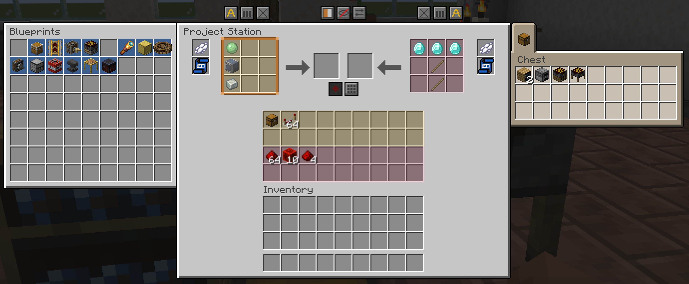

# Project Station

The **Project Station** is the double bench you get when a [Project Bench Slab](Project-Bench-Slab.md) joins another slab or a [Project Bench](Project-Bench.md). It opens as one wide window with two grids. Both halves share their storage.

| | |
|---|---|
| **Type** | Double bench (two joined blocks) |
| **Stack size** | Not an item |
| **Obtained by** | Joining a slab to a slab or a bench |
| **Config section** | [Slab and Project Station](Configuration.md#slab-and-project-station), [Project Station colours](Configuration.md#project-station-colours) |

## Building one

Place a slab next to another slab or a bench, facing the same way. See [Joining](Project-Bench-Slab.md#joining) for the rules.

## Using it

*The Project Station window: two grids, each with its own blueprint, result and storage*

Open either half. The window has these parts:

1. **Two grids**: one for each half. Each has its own blueprint slot, dye slot, result and recipe button.
2. **Auto, Balance and Clear**: one set for each grid. They always work on their own grid.
3. **Active grid switch, Showcase and Share**: one of each for the pair.
4. **Record and Fill**: one of each. They work on the active grid.
5. **Storage**: both halves' storage. Each half has its own tint colour, so you can tell them apart.
6. **Archive panel and chest panel**: the archives and chests next to either half.

### The active grid

Both grids always craft. One of them is the **active** grid, marked in the window. Items from outside go to the active grid:

- Shift-clicks from your inventory or from a chest tab.
- JEI and EMI recipe filling.
- Polymorph's recipe picker.
- **Record** and **Fill**.

The active grid belongs to the Station, not to you. When someone switches it, everyone in the window sees the change. A new Station starts on the first grid.

### Shared stock

The two halves share their storage:

- A craft on either grid refills from both storages, its own half first.
- **Fill**, **Clear** and crafting leftovers use both storages, its own half first.
- Shift-click from your inventory fills the active half's storage first, then the other.

### Chests next to the Station

**Share** is one switch for the pair. Press it on either half and both change.

- The chest panel lists the chests next to both halves, up to eight tabs.
- A double chest touching both halves counts once.
- The archive panel lists the archives touching either half.

### Breaking

Break either half and the window closes. Each half drops its own items.

## Controls

| Control | Where | What it does | Notes |
|---|---|---|---|
| **Auto**, **Balance**, **Clear** | One set per grid | Work on their own grid. | Same as on the [Project Bench](Project-Bench.md#controls). |
| Active grid switch | Station window | Makes the other grid active. | Its tooltip says which grid is active. |
| **Tab** key | While the window is open | Makes the other grid active. | Change the key in Controls, under Project Bench. |
| **Showcase** | Station window | Shows or hides the active half's grid on top of it. | Each half shows its own grid. |
| **Share** | Station window | Sets which chests the pair uses. | One switch for both halves. |
| **Record**, **Fill** | Station window | Work on the active grid. | See [Blueprints](Blueprints.md). |

## Tips

- Keep one recipe laid out in each grid, and craft from both without switching.
- Switch the active grid with **Tab** before you shift-click a stack in.
- Put a different blueprint in each half for two recipes that share ingredients.

## Compatibility

- **JEI** and **EMI**: fill the active grid, taking from the active half's storage, then the other's, then yours.
- **Jade**: shows both grids' recipes when you look at either half.
- **Inventory Profiles Next**: sorts both halves' storage.

Details are on [Works With Other Mods](Works-With-Other-Mods.md).

## Configuration

Server owners can turn off the shared storage, so each half uses only its own. Each player picks the two tint colours. See [Slab and Project Station](Configuration.md#slab-and-project-station) and [Project Station colours](Configuration.md#project-station-colours).

## See also

- [Project Bench Slab](Project-Bench-Slab.md)
- [Project Bench](Project-Bench.md)
- [Hoppers and Pipes](Hoppers-and-Pipes.md)

[Back to Home](Home.md)
