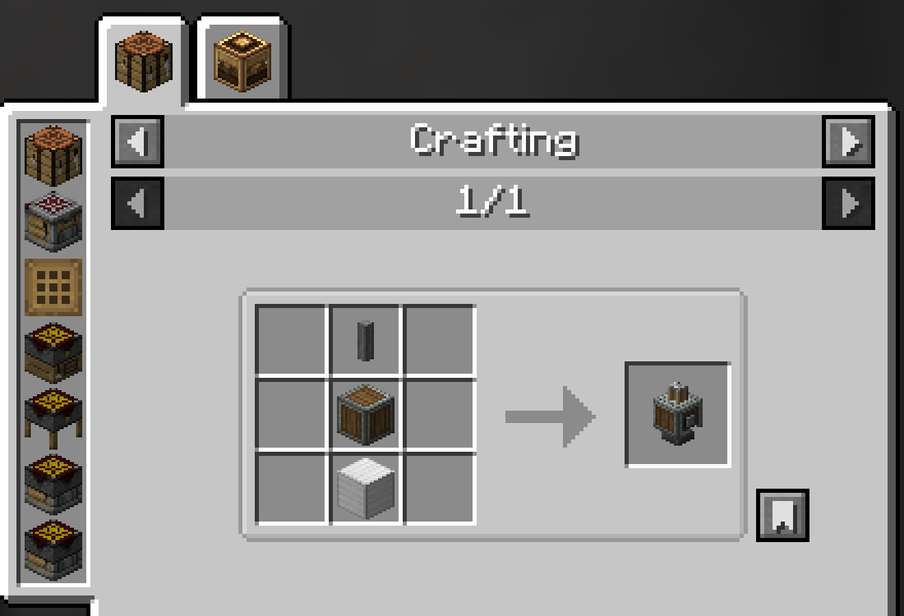
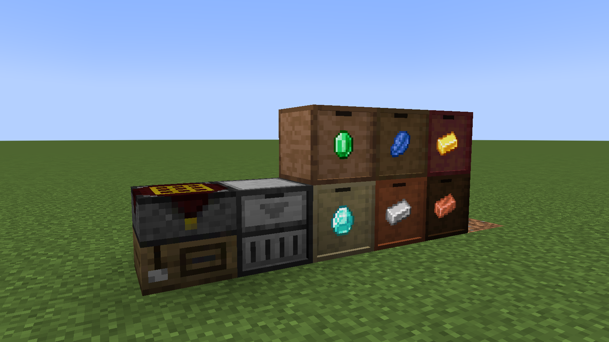
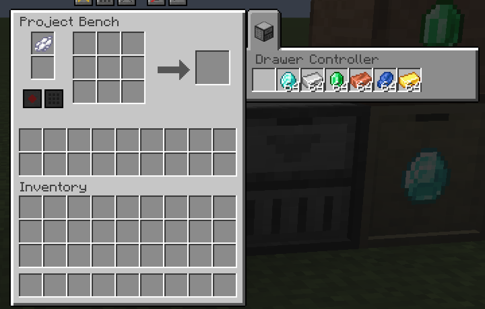
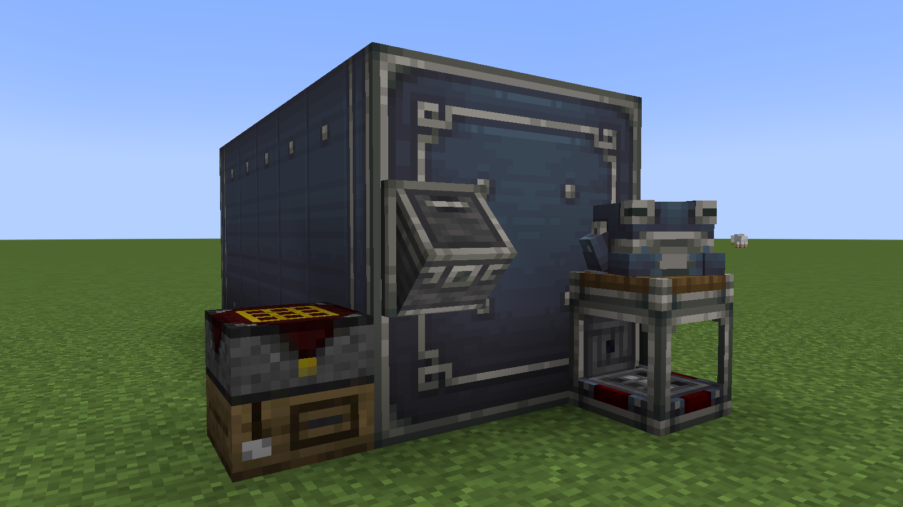
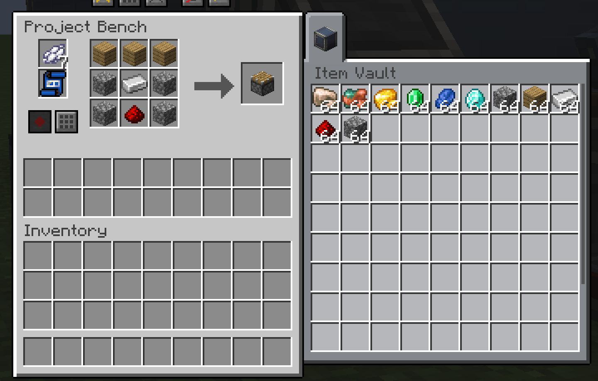

# Works With Other Mods

Project Bench works with several popular mods. None of them is required. Each player can turn each one off in their own [client file](Configuration.md#other-mods).

## JEI

*JEI's crafting recipes, with the Project Bench and its variants listed as crafting stations*

- The bench is listed as a crafting station, next to every crafting recipe.
- Click the arrow in the bench's window to see all crafting recipes.
- Press a recipe's **+** and JEI lays it out in the grid, from the bench's storage and your inventory.
- With a blank blueprint and its dye in the bench, **+** also records the recipe, even if you lack items. The missing ones show as ghosts. See [Blueprints](Blueprints.md#recording-from-jei-or-emi).
- On a [Project Station](Project-Station.md), **+** fills the active grid.
- Anything your server turned off is hidden from JEI.

## EMI

- The bench is listed as a crafting workstation.
- EMI's fill button lays a recipe out in the grid.
- With a blank blueprint and its dye in the bench, the fill button also records the recipe, like JEI's **+**.
- On a [Project Station](Project-Station.md), it fills the active grid.

## Jade

- Look at a bench to see which recipe it is set to make.
- When the grid matches more than one recipe, Jade says which one.
- On a [Project Station](Project-Station.md), it shows both grids' recipes.
- On an [Auto Project Bench](Auto-Project-Bench.md), it says whether automation is on.
- Jade never shows what a bench holds.

## Polymorph

- When the grid matches more than one recipe, Polymorph's button picks one. It replaces the bench's own recipe button.
- If you turn it off in your client file, restart the game.

## Mouse Tweaks

The scroll wheel moves items the way the bench's shift-click does:

- **From your inventory**: to the bench's storage, then to grid slots that already hold the item or that a ghost asks for.
- **From the storage**: to the grid, then to the open chest tab when **Share** allows it, then to you.
- **From the grid**: to the storage, then to you.
- **From the result**: crafts into your inventory.

The wheel never puts an item in an empty grid slot that nothing asks for. Mouse Tweaks' drags work like your own clicks.

## Inventory Profiles Next

- Sorting only touches the bench's storage and your own inventory. On a Project Station, it sorts both halves' storage.
- It never sorts the grid, the blueprint slots or the chests next to the bench.
- Its scroll and move-all keys move items into and out of the storage, never into the grid.
- With Mouse Tweaks too, both mods react to the scroll wheel. Hold Left Control while scrolling to keep Inventory Profiles Next out of it.
- Or unbind its "Scroll to chest" and "Scroll to inventory" keys in its settings.

## Storage Drawers

*A bench beside a Drawer Controller and a wall of drawers*

*The bench window with the Drawer Controller's tab open, listing the drawers it sees*

- A Drawer Controller next to the bench shows all the drawers it sees in one tab.
- The Drawer Controller (and its IO and framed versions) is listed by default in `bench.external.alwaysShow`, so it gets its tab even though it shows different slots on different sides. See [Chests next to the bench](Configuration.md#chests-next-to-the-bench).
- A drawer never gives you more than one full stack per click, even with the Creative Vending Upgrade. A right click gives half a stack. Clicking a drawer with an item in your hand does nothing: use shift-click to put items in.

## Create

*A bench beside a large Create Item Vault*

*The bench window with an Item Vault's tab open, showing its items*

- Create's Item Vault next to the bench shows its items in its tab.
- You cannot take from it or put into it by hand, as in Create.
- The bench still uses it as **Share** says: crafting and **Fill** take from it, and **Clear** can send items to it.
- Moving a bench whole with a contraption keeps everything inside.

## Configuration

Each mod has an on/off switch in your own client file. See [Other mods](Configuration.md#other-mods). Inventory Profiles Next, Storage Drawers and Create have no switch there. Server owners can make the Item Vault work like any other chest: see [Chests next to the bench](Configuration.md#chests-next-to-the-bench).

## See also

- [Project Bench](Project-Bench.md)
- [Blueprints](Blueprints.md)
- [Configuration](Configuration.md)

[Back to Home](Home.md)
